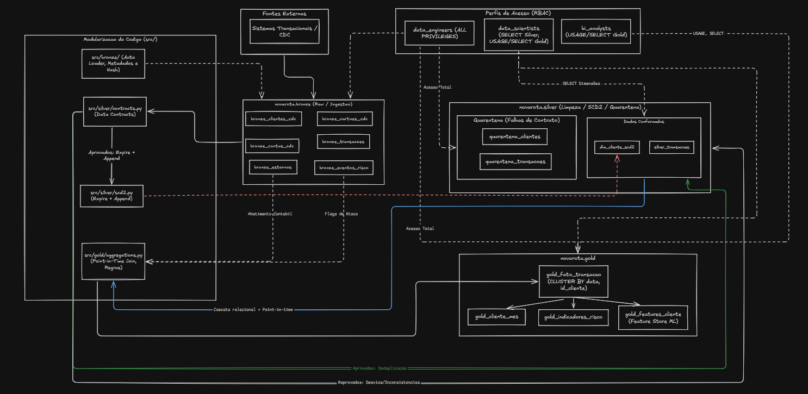

# Cooperativa Nova Rota

Proposta para uma pipeline de engenharia de dados, desenvolvida sobre a arquitetura do databricks e UC (Unity Catalog), estruturada seguindo o padrao medalhão (bronze, silver e gold).

O sistema implementa uma pipe de ingestao incremental orientada a contratos de dados, isolamento de registros nao conformes em quarentena tecnica, gestao de historico cadastral com SCD Tipo 2 desacoplado para eliminacao de conflitos de concorrencia em operacoes de merge, e materializacao de produtos de dados analiticos para consumo corporativo, prevencao a fraudes e modelagem estatistica.

---

## Base da Arquitetura

O ambiente opera sob o namespace de tres niveis do Unity Catalog (`novarota.<schema>.<tabela>`), garantindo isolamento logico, governanca centralizada de acessos e linhagem tecnica:

```text
                              [Fontes Transacionais / CDC]
                                          |
                                          v 
                                Auto Loader (cloudFiles)

                                 [ novarota.bronze.* ]

        Ingestao append-only, metadados tecnicos e schema rescue (_rescued_data)
                                          |
                                          v 
                      Contratos de Dados & SCD Tipo 2 (Expire + Append)

                               [ novarota.silver.* ]

             Dados tipados, dimensoes historicas e tabelas de quarentena
                                          |
                                          v 
                    Resolucao Temporal & Agregacoes de Negocio

                                 [ novarota.gold.* ]

          Data Products analiticos (Fato Transacao, Metricas, Risco, Features)
```
**Documentacao tecnica complementar disponivel em:**
   - docs/architecture.md: desenho arquitetural detalhado e fluxo de transformacao

   - docs/data_contracts.md: especificacao de schemas, regras de validacao e quarentena

   - docs/decisions.md: registros formais de decisao arquitetural



---

## O que você irá encontrar nesse repostório

```
├── .github/workflows/       # Esteiras de CI/CD para automacao e testes
├── docs/                    # tecnica de engenharia e governanca
│   ├── architecture.md      # linhagem e governanca no UC
│   ├── data_contracts.md    # specs dos contratos e politicas de quarentena
│   └── decisions.md         # ADRs
├── notebooks/               # notebooks de execucao e demonstracao no databricks
│   ├── bronze_ingestion.ipynb
│   ├── silver_processing.ipynb
│   └── gold_data_product.ipynb
├── sql/                     # coonsultsas analiticas avancadas (Window Functions, CTEs)
│   └── advanced_analytics.sql
├── src/                     # codigo modular em py desacoplado de notebooks
│   ├── bronze/              # metodos de ingestao e injecao de metadados
│   ├── silver/              # validacao contratual, quarentena e algoritmo SCD2
│   └── gold/                # regras de agregacao e construcao dos data products
├── tests/                   # testes unitarios automatizados (em pytest)
│   └── test_silver_contracts.py
├── config.py                # parametrizacao de catalogos, esquemas e caminhos
├── requirements.txt         # specs deterministica de dependencias py
└── README.md
```
---

## Definição da orquestracao e Pipeline (Databricks Workflows/Jobs)

O pipe é executado como um grafo direcionado (dag) sequencial no databricks Workflows por meio do job pipeline_lakehouse_cooperativa_novarota, com integracao direta a branch do git.

### Especificacao Declarativa do Job (em yaml)

```YAML
resources:
  jobs:
    pipeline_lakehouse_cooperativa_novarota:
      name: pipeline_lakehouse_cooperativa_novarota
      tasks:
        - task_key: bronze_ingestion
          notebook_task:
            notebook_path: notebooks/bronze_ingestion.ipynb
            source: GIT
          environment_key: Default

        - task_key: silver_processing
          depends_on:
            - task_key: bronze_ingestion
          notebook_task:
            notebook_path: notebooks/silver_processing.ipynb
            source: GIT
          environment_key: Default

        - task_key: gold_data_product
          depends_on:
            - task_key: silver_processing
          notebook_task:
            notebook_path: notebooks/gold_data_product.ipynb
            source: GIT
          environment_key: Default

      git_source:
        git_url: [https://github.com/jeremiasgehm/cooperativa_novarota](https://github.com/jeremiasgehm/cooperativa_novarota)
        git_provider: gitHub
        git_branch: develop

      queue:
        enabled: true

      environments:
        - environment_key: Default
          spec:
            environment_version: "6"

      performance_target: PERFORMANCE_OPTIMIZED
```
---
## Decisoes para a arquitetura e engenharia

### Bronze (novarota.bronze)

  - Ingestao incremental baseada em Databricks auto load ```(format("cloudFiles"))```, orientada por checkpoints no armazenamento em nuvem, eliminando overhead de listagem recursiva de diretorios

  - Resiliencia a quebra de contratos via coluna tecnica ```_rescued_data```, preservando campos nao mapeados para auditoria sem abortar o processamento

  - Ingecao padronizada de metadados de auditoria forense: ```_timestamp_ingestao```, ```_arquivo_origem```, ```_batch_id``` e ```_hash_linha```

### Silver (novarota.silver)

- Inspecao contratual orientada ao padrao nonbreaking pipeline: registros em desacordo com as regras de tipagem ou valores permitidos sao direcionados para ```quarentena_clientes``` e ```quarentena_transacoes```, com descricao do erro em ```motivo_quarentena``` e ```timestamp``` de deteccao.

- Algoritmo de slwo changing dimensions (SCD2) desacoplado em padrao expir + append para eliminar o erro ```DELTA_MULTIPLE_SOURCE_ROW_MATCHING_TARGET_ROW_IN_MERGE```:

    - Deduplicacao intra lote utilizando funcao de janela particionada por id_cliente e ordenada por data_atualizacao DESC

    - Etapa 1: Merge unicamente com clausula UPDATE para expirar versoes vigentes que sofreram alteracao de atributos de negocio ```flag_ativo = false, data_fim_vigencia = ts```

    - Etapa 2: Append direto das novas versoes vigentes caso seja constatada mutacao cadastral via hash criptografico SHA-256 ```_hash_diff```

### Camada Gold (novarota.gold)

  **novarota.gold.gold_fato_transacao:**

   - granularidade: uma linha por transacao (id_transacao).

   - rules: Resolucao relacional em cascata (transacao -> cartao -> conta -> cooperado), join temporal pontual (point-in-time) com a dimensao de cooperados, abatimento integral de estornos no montante liquido (valor_liquido = 0.00 em transacoes estornadas) e enriquecimento de severidade de risco

  **novarota.gold.gold_cliente_mes:**

   - granularidade: Uma linha por cooperado e mes de referencia (id_cliente, ano_mes).

   - metricas: Volume bruto e liquido, quantidade de transacoes por status (aprovadas, negadas, estornadas), ticket medio liquido e dispersao de canais de atendimento

  **novarota.gold.gold_indicadores_risco:**

   - granularidade: Uma linha por canal e mes (ano_mes, canal)

   - metricas: Percentual de incidentes de risco, taxa de estorno e volumetria de alertas com severidade alta

  **novarota.gold.gold_features_cliente:**

   - granularidade: Uma linha por cooperado ativo (id_cliente)

   - Tabela analitica para algoritmos de Machine Learning (media de gastos, desvio padrao amostral, maxima transacao historica, taxa de recusa operacional e recencia transacional em dias)

---

## Testes

O projeto contem testes unitarios implementados com pytest em ```tests/test_silver_contracts.py```, estruturados com fixtures compativeis tanto com clusters Databricks gerenciados (Spark Connect) quanto com ambientes locais e esteiras de CI/CD.

Cenarios cobertos:

  - Validacao de regras contratuais e roteamento para quarentena tecnica com preservacao de integridade

  - Deteccao deterministica de alteracao em atributos de negocio via calculo de _hash_diff

---

# Instrucoes de Execucao

### Pre-requisitos

- Databricks com suporte a Unity Catalog ativo
- Recurso computacional alocado (serverless ou cluster runtime 14+).
- Repositorio clonado via databricks Git folders

#### 1- Execucao Automatizada (databricks workflows)

1. No menu databricks, acesse a secao **Workflows** > **Jobs**
2. Selecione o job `pipeline_lakehouse_cooperativa_novarota`
3. Clique em **Run now** para acionar o DAG completo (`bronze_ingestion` -> `silver_processing` -> `gold_data_product`)

#### 2- Execucao Manual (desenvolvimento)

Para execucoes interativas via notebooks:

1. `notebooks/bronze_ingestion.ipynb`: consumo incremental das fontes e persistencia brutq
2. `notebooks/silver_processing.ipynb`: validacao de contratos, quarentena e ingestao dimensional SCD Tipo 2
3. `notebooks/gold_data_product.ipynb`: construcao das tabelas analiticas

#### 3- Consultas Analiticas Avancadas

Execute as consultas contidas em `sql/advanced_analytics.sql` no SQL Editor do Databricks para:

- Calculo de variacao percentual mes contra mes (MoM) com `LAG`
- Identificacao de primeiro e ultimo canal transacionado com `FIRST_VALUE` e `LAST_VALUE`
- Segmentacao de cooperados em decis financeiros com `NTILE` e `PERCENT_RANK`
- Deteccao de desvios e anomalias de consumo baseada em multiplicador de media historica
- Benchmark de cooperado frente ao seu grupo de comparacao (cidade e segmento)
- Atualizacao incremental em Delta Lake utilizando sintaxe declarativa `MERGE INTO`

--- 

## Governanca, Performance e Trade-offs

- Liquid Clustering: Para a tabela `gold_fato_transacao`, em cenarios de crescimento acentuado de volume, recomenda-se a adocao de Liquid Clustering (`CLUSTER BY (data_referencia, id_cliente)`) em substituicao ao particionamento estatico, evitando degradacao por criacao excessiva de arquivos pequenos (*small files*).
- Politica de Controle de Acesso (Unity Catalog): Segregacao estrita entre camadas de dados baseada em papeis:SQL
    
    ```
    GRANT USAGE ON CATALOG novarota TO `bi_analysts`;
    GRANT SELECT ON SCHEMA novarota.gold TO `bi_analysts`;
    REVOKE ALL PRIVILEGES ON SCHEMA novarota.bronze FROM `bi_analysts`;
    ```
    
- Observabilidade: Monitoramento de SLAs de processamento e limites operacionais via alertas configurados no Databricks Workflows, com notificacoes acionadas quando a taxa de linhas retidas em quarentena exceder limites parametricos predefinidos.

--- 
## Governanca, performance e Trade-off

- Para a tabela `gold_fato_transacao`, em cenarios de crescimento acentuado de volume, recomenda-se a adocao de Liquid Clustering (`CLUSTER BY (data_referencia, id_cliente)`) em substituicao ao particionamento estatico, evitando degradacao por criacao excessiva de arquivos pequenos (*small files*)

- Politica de Controle de Acesso (Unity Catalog): Segregacao estrita entre camadas de dados baseada em papeis:
    
    ```SQL
    GRANT USAGE ON CATALOG novarota TO `bi_analysts`;
    GRANT SELECT ON SCHEMA novarota.gold TO `bi_analysts`;
    REVOKE ALL PRIVILEGES ON SCHEMA novarota.bronze FROM `bi_analysts`;
    ```
    
- observabilidade: monitoramento de SLAs de processamento e limites operacionais via alertas configurados no Databricks, com notificacoes acionadas quando a taxa de linhas retidas em quarentena exceder limites parametricos predefinidos